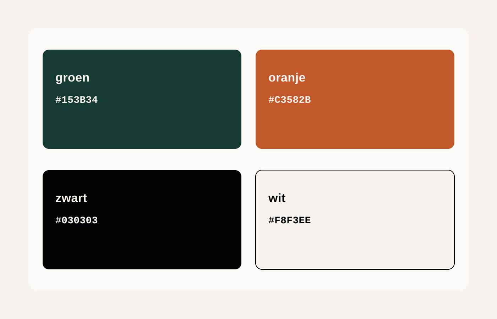

**Workshop, CRM, invoicing and accounting software for agricultural machinery dealers.**

Agrivaro is a modular, multi-tenant suite for agricultural machinery dealers:
workshop planning, machine and customer records, quotations, invoicing and
accounting in the office, plus an offline-first app for the technician on the
shop floor.

## What we build

| Product | What it is |
| --- | --- |
| Agrivaro CRM | The dealer's back office: workshop planning, CRM, quotations, invoicing and accounting. |
| Technician app | Offline-first mobile app: jobs, photos, checklists and hours. |
| Marketing website | Dutch-language product site. |
| User manual | Task-based documentation for dealers (Dutch). |

Our repositories are private. Members reach them from the **Repositories** tab
and pick up work from the pinned repositories. Pull requests follow the
default template in [`agrivaro/.github`](https://github.com/agrivaro/.github).

## Brand

The four brand colours are authoritative in the private `branding`
repository; the values below are its `hexcode.md`.

| Colour | Hex | Role |
| --- | --- | --- |
| Green | `#153B34` | Primary — buttons, links, focus rings, logo |
| Orange | `#C3582B` | Accent — badges, highlights, used sparingly |
| Black | `#030303` | Text; page background in dark mode |
| White | `#F8F3EE` | Page background, text on green |

Two rules that bite in practice: **text on orange is black, never white**, and
**on a green or black ground use light orange `#D9713F`**. A brand change
starts in the `branding` repository and is mirrored into the CRM and website
in the same work item.
